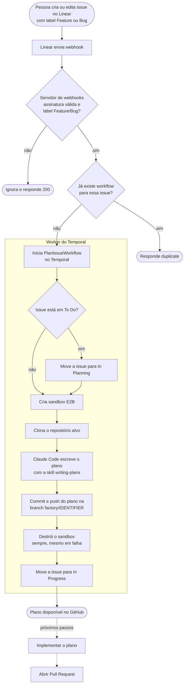

# Software Factory

## O que é

Uma "fábrica de software" experimental: a ideia é que uma tarefa escrita no Linear vire código
pronto para revisão sem que ninguém precise programar à mão.

O caminho completo que queremos automatizar é:

1. alguém cria uma issue no Linear descrevendo uma funcionalidade ou um bug;
2. a fábrica escreve um **plano** de como resolver;
3. a fábrica **implementa** o plano;
4. a fábrica abre um **Pull Request** no GitHub para uma pessoa revisar.

Hoje (fase de teste) a fábrica faz as etapas 1 e 2: ela recebe a issue, escreve o plano e salva
esse plano numa branch do repositório. Implementar e abrir o PR ainda está por vir.

Quem faz o trabalho "inteligente" é o **Claude Code**, rodando dentro de uma máquina isolada e
descartável (sandbox do **E2B**). Quem coordena os passos, tenta de novo quando algo falha e
garante que nada fique pela metade é o **Temporal**.

## Como funciona hoje



As linhas pontilhadas são etapas planejadas, ainda não implementadas.

## Requisitos

- Python 3.12+
- [uv](https://docs.astral.sh/uv/)
- [Temporal CLI](https://docs.temporal.io/develop/python/set-up-your-local-python)

## Setup

```bash
uv venv .venv
source .venv/bin/activate
uv pip install -e ".[dev]"
cp .env.example .env   # preencha os segredos (ver abaixo)
```

## Temporal (servidor local)

Em um terminal separado:

```bash
temporal server start-dev
```

- Temporal Service: `localhost:7233`
- Web UI: http://localhost:8233

## Variáveis de ambiente

| Variável | Usada por | Descrição |
| --- | --- | --- |
| `LINEAR_WEBHOOK_SECRET` | webhook | signing secret do webhook do Linear |
| `HOST` / `PORT` | webhook | bind do servidor (default `0.0.0.0:8000`) |
| `TEMPORAL_ADDRESS` | ambos | default `localhost:7233` |
| `TASK_QUEUE` | ambos | default `software-factory` |
| `E2B_API_KEY` | worker | chave da API do E2B |
| `E2B_TEMPLATE` | worker | template do sandbox (default `claude`) |
| `ANTHROPIC_API_KEY` | worker | auth do Claude Code via API (cobrança por token) |
| `CLAUDE_CODE_OAUTH_TOKEN` | worker | alternativa: token da assinatura Claude (`claude setup-token`); defina só uma das duas |
| `GITHUB_TOKEN` | worker | token fine-grained restrito ao repo alvo, com **Contents: Read and write** |
| `TARGET_REPO` | worker | repo que a fábrica opera (`owner/repo`) |
| `LINEAR_API_KEY` | worker | personal API key do Linear, com escrita em issues (muda o status) |

## Worker (Temporal + E2B)

```bash
software-factory-worker
```

Para cada issue aceita pelo webhook, o `PlanIssueWorkflow` (id `plan-issue-<issue id>`):

1. move a issue de `To Do` para `In Planning` no Linear (se ela não estiver em `To Do`, não move
   e segue planejando);
2. cria um sandbox E2B (template `claude`);
3. clona `TARGET_REPO` em `/home/user/repo`;
4. roda `claude -p` com a skill `writing-plans` (superpowers, vendorizada) para escrever o plano em
   `docs/superpowers/plans/<IDENTIFIER>.md` — o Claude só pode ler o repo e escrever esse arquivo;
5. commita o plano e faz push na branch `factory/<IDENTIFIER>`;
6. destrói o sandbox (sempre, inclusive em falha);
7. move a issue para `In Progress`.

Os status `To Do`, `In Planning` e `In Progress` precisam existir no time da issue (o nome é
comparado sem diferenciar maiúsculas). Em falha a issue fica no status em que estava, normalmente
`In Planning`. A API do Linear é só GraphQL (`https://api.linear.app/graphql`), chamada com `httpx`.

O plano e a branch ficam no resultado do workflow, na UI do Temporal (http://localhost:8233).

## Executar (servidor de webhooks)

```bash
software-factory          # lê .env; sobe em HOST:PORT (default 0.0.0.0:8000)
# ou
uvicorn software_factory.api:create_app --factory --env-file .env --reload
```

Endpoints:

- `GET /health` → `{"status": "ok"}`
- `POST /webhooks/linear` → recebe webhooks do Linear

## Webhook do Linear

O Linear exige uma URL HTTPS pública. Localmente, exponha a porta com um túnel:

```bash
ngrok http --url=<seu-dominio>.ngrok-free.app 8000
# ou
cloudflared tunnel --url http://localhost:8000
```

No Linear: **Settings → API → Webhooks → New webhook**

- URL: `https://<túnel>/webhooks/linear`
- Resource types: **Issues**
- Copie o *signing secret* para `LINEAR_WEBHOOK_SECRET` no `.env`

O endpoint valida a assinatura (`Linear-Signature`, 401 se inválida) e o
`webhookTimestamp` (400 se tiver mais de 60s), e aceita apenas issues **criadas**
com label `Feature`/`Bug` ou **atualizadas** recebendo uma dessas labels. Os demais
eventos retornam 200 `{"status": "ignored"}`. Issues aceitas iniciam o workflow
(`{"status": "accepted"}`, ou `"duplicate"` se já houver um rodando para a issue);
se o Temporal estiver indisponível, responde 503 para o Linear reenviar.

## Testes

```bash
PYTHONPATH=src python3 -m unittest discover -s tests
```
