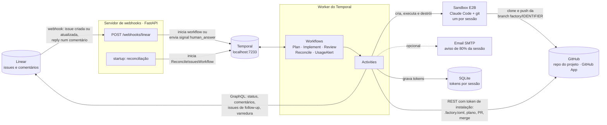
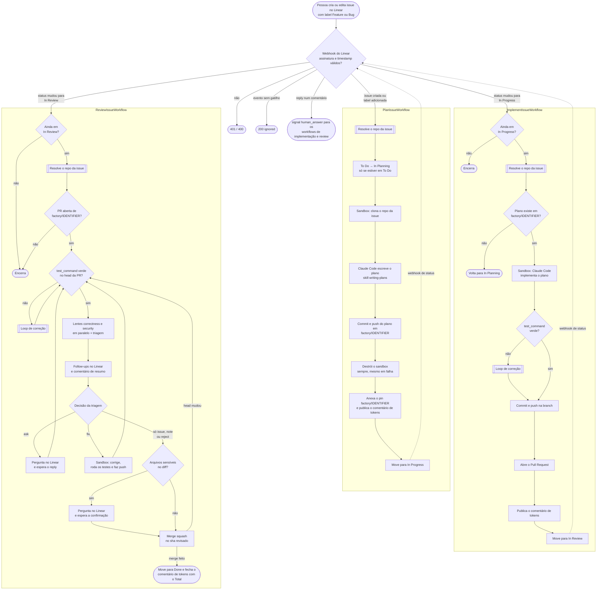
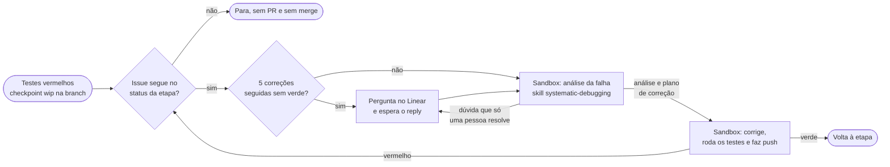

# Software Factory

## O que é

Uma "fábrica de software" experimental: a ideia é que uma tarefa escrita no Linear vire código
pronto para revisão sem que ninguém precise programar à mão.

O caminho completo que queremos automatizar é:

1. alguém cria uma issue no Linear descrevendo uma funcionalidade ou um bug;
2. a fábrica escreve um **plano** de como resolver;
3. a fábrica **implementa** o plano;
4. a fábrica abre um **Pull Request** no GitHub, revisa o código, corrige o que for preciso e faz o merge.

Hoje (fase de teste) a fábrica faz as quatro etapas: ela recebe a issue, escreve o plano e salva
esse plano numa branch do repositório; quando a issue entra em `In Progress`, implementa o plano,
roda os testes e, se ficarem vermelhos, entra num loop de análise e correção até ficarem verdes;
só então abre o PR e move a issue para `In Review`. Em `In Review`, revisa a PR, corrige o que a
review apontar e, aprovada, faz o merge **sem humano** (salvo arquivos sensíveis, que pedem
confirmação) e move a issue para `Done`. Dúvidas grandes viram comentário na issue, e a resposta é
um reply nesse comentário. Achados da review que não bloqueiam o merge podem virar issues de
follow-up no Linear.

Além disso, ao subir, o servidor de webhooks **reconcilia** as issues cujos eventos se perderam
enquanto ele estava fora, e o worker pode mandar um **email** quando a sessão do Claude passa de
80% da janela de uso. Cada etapa publica na issue um comentário com os tokens e o custo
estimado das sessões do Claude.

Não há repo fixo: cada issue é resolvida para o repo linkado no seu projeto do Linear, com o
comando de testes vindo do `.factory.toml` desse repo (ver [Repo de cada projeto](#repo-de-cada-projeto)).

Quem faz o trabalho "inteligente" é o **Claude Code**, rodando dentro de uma máquina isolada e
descartável (sandbox do **E2B**). Quem coordena os passos, tenta de novo quando algo falha e
garante que nada fique pela metade é o **Temporal**.

## Como funciona hoje

São três processos: o **servidor de webhooks** (FastAPI), que recebe os eventos do Linear e
inicia workflows no Temporal; o **servidor do Temporal**, que guarda o estado de cada workflow; e
o **worker**, que executa os workflows e as activities (Linear, GitHub, E2B, email, SQLite de tokens). O status da
issue no Linear é o que move a fábrica de uma etapa para a outra:

`To Do` → `In Planning` → `In Progress` → `In Review` → `Done`

| Workflow | Id | Começa quando | Termina |
| --- | --- | --- | --- |
| `PlanIssueWorkflow` | `plan-issue-<issue id>` | issue criada com label `Feature`/`Bug`, ou recebe uma | plano commitado; issue em `In Progress` |
| `ImplementIssueWorkflow` | `implement-issue-<issue id>` | issue entra em `In Progress` | testes verdes, PR aberta; issue em `In Review` |
| `ReviewIssueWorkflow` | `review-issue-<issue id>` | issue entra em `In Review` | PR mergeada (squash); issue em `Done` |
| `ReconcileIssuesWorkflow` | `reconcile-issues` | startup do servidor de webhooks | workflows perdidos iniciados |
| `UsageAlertWorkflow` | `usage-alert-five-hour-<resetsAt>` | sessão do Claude passa de 80% da janela de 5h | email enviado |

### Visão geral



### Ciclo de uma issue



"Resolve o repo" usa o pin anexado à issue ou, sem ele, o link do projeto e o `.factory.toml`; se
falhar, o workflow comenta o motivo na issue e falha.

Depois de `MAX_REVIEW_ROUNDS = 3` rodadas sem merge, ou se o GitHub recusar o merge (conflito,
branch protection), a review também pergunta no Linear antes de seguir.

### Loop de correção

Usado pela implementação e pela review sempre que o `test_command` do `.factory.toml` fica vermelho. Cada sessão
(análise ou correção) roda num sandbox novo e deixa um checkpoint `wip` na branch.



Toda pergunta vira um comentário na issue; a resposta é um **reply na thread desse comentário**.
Sem resposta em 7 dias o workflow falha. Para parar uma etapa, mova a issue para fora do status
dela.

## Requisitos

- Python 3.12+
- [uv](https://docs.astral.sh/uv/)
- [Temporal CLI](https://docs.temporal.io/develop/python/set-up-your-local-python)

## Setup

```bash
uv venv .venv
source .venv/bin/activate
uv pip install -e ".[dev]"
cp .env.example .env   # preencha os segredos (ver abaixo)
```

## Temporal (servidor local)

Em um terminal separado:

```bash
temporal server start-dev --db-filename temporal.db
```

Sem `--db-filename` o histórico fica em memória e some quando o servidor reinicia. O namespace
`default` do servidor de dev guarda workflows fechados por **24h**. As duas coisas afetam a
[reconciliação no startup](#reconciliação-no-startup). Para recuperar eventos de paradas mais
longas, aumente a retenção uma vez:

```bash
temporal operator namespace update --namespace default --retention 30d
```

- Temporal Service: `localhost:7233`
- Web UI: http://localhost:8233

## Variáveis de ambiente

| Variável | Usada por | Descrição |
| --- | --- | --- |
| `LINEAR_WEBHOOK_SECRET` | webhook | signing secret do webhook do Linear |
| `HOST` / `PORT` | webhook | bind do servidor (default `0.0.0.0:8000`) |
| `TEMPORAL_ADDRESS` | ambos | default `localhost:7233` |
| `TASK_QUEUE` | ambos | default `software-factory` |
| `E2B_API_KEY` | worker | chave da API do E2B |
| `E2B_TEMPLATE` | worker | template do sandbox (default `claude`) |
| `ANTHROPIC_API_KEY` | worker | auth do Claude Code via API (cobrança por token) |
| `CLAUDE_CODE_OAUTH_TOKEN` | worker | alternativa: token da assinatura Claude (`claude setup-token`); defina só uma das duas |
| `GITHUB_APP_ID` | worker | id do GitHub App (ver "GitHub App") |
| `GITHUB_APP_PRIVATE_KEY_PATH` | worker | caminho do arquivo `.pem` com a private key do GitHub App |
| `LINEAR_API_KEY` | worker | personal API key do Linear, com escrita em issues (muda o status) |
| `SMTP_HOST` | worker | opcional: servidor SMTP do aviso de uso (ex.: `smtp.gmail.com`); sem ele o aviso fica desligado |
| `SMTP_PORT` | worker | porta SMTP com STARTTLS (default `587`) |
| `SMTP_USERNAME` / `SMTP_PASSWORD` | worker | login SMTP (no Gmail, senha de app; exige 2FA); obrigatórias com `SMTP_HOST` |
| `ALERT_EMAIL_FROM` | worker | remetente do aviso (default `SMTP_USERNAME`) |
| `ALERT_EMAIL_TO` | worker | destinatário do aviso; obrigatória com `SMTP_HOST` |
| `ALERT_TIMEZONE` | worker | fuso do horário do reset no email (default `America/Sao_Paulo`) |
| `TOKEN_USAGE_DB` | worker | opcional: arquivo SQLite do uso de tokens (default `token_usage.db`); no WSL com o repo em `/mnt/c` ou OneDrive, prefira um caminho no lado Linux (ex.: `~/.local/share/software-factory/token_usage.db`): o lock do SQLite em drvfs não é confiável, a sincronização pode travar ou reverter o arquivo, e erro de escrita só vira warning no log |

### GitHub App

A fábrica acessa o GitHub como um GitHub App, não com um token pessoal.

1. Crie o App na conta/org dos repos, **sem webhook**, com as permissões **Contents: Read and
   write**, **Pull requests: Read and write** e **Metadata: Read**.
2. Instale o App só nos repos da fábrica: a instalação é a lista de repos permitidos.
3. Gere e baixe a private key (`.pem`) e preencha `GITHUB_APP_ID` e `GITHUB_APP_PRIVATE_KEY_PATH`.

O worker gera, por issue, um token de instalação restrito ao repo dela (validade de 1h, renovado
com 10 min de margem). Ao trocar o `GITHUB_TOKEN` por este App (ou ao mudar assinaturas de
activities), faça o deploy do worker sem nenhum `plan-issue-*`, `implement-issue-*` ou
`review-issue-*` rodando.

### Repo de cada projeto

Não há repo fixo: cada issue diz em qual repo a fábrica trabalha, pelo projeto do Linear em que ela
está.

1. Nos **Resources** do projeto no Linear, adicione um link para o repo do GitHub
   (`https://github.com/<owner>/<repo>`; variantes como `.git`, `/tree/main` ou `www.` também
   valem). O projeto precisa ter links para **exatamente um** repo.
2. Na raiz do repo, na **branch default**, crie um `.factory.toml` com o comando que roda os testes
   no sandbox (exit 0 = verde; a PR só abre com verde):

   ```toml
   test_command = "uv pip install --system -e \".[dev]\" && python -m pytest"
   ```

3. O GitHub App precisa estar instalado nesse repo.

Um anexo da issue que aponta para `https://github.com/<owner>/<repo>/tree/factory/<...>` (o "pin")
vence o link do projeto; para trocar o repo de uma issue com pin, apague o anexo. Cada workflow
resolve o repo uma vez, no início (o planejamento antes de mover a issue para `In Planning`; a
implementação e a review logo depois de conferir o status). Se não der para resolver (issue sem
projeto, projeto sem link ou com mais de um repo, repo sem acesso ou sem `.factory.toml` válido), o
workflow comenta o motivo na issue e falha. Corrija o link ou o `.factory.toml` e dispare a etapa
de novo: no planejamento, remova e adicione de novo a label `Feature`/`Bug`; na implementação e na
review, tire a issue do status (`In Progress` / `In Review`) e volte para ele. O `.factory.toml` é
um arquivo sensível na review: PR que o muda só é mergeada com confirmação de uma pessoa.

### Aviso de uso da sessão do Claude

Com `CLAUDE_CODE_OAUTH_TOKEN` e `SMTP_HOST` configurados, o worker lê os eventos `rate_limit_event`
que o Claude Code emite no stream-json de toda sessão (planejamento, implementação, análise, correção
e review). Quando a janela de 5 horas da assinatura passa de 80%, ele manda um email com o percentual
e o horário em que o limite reseta. Sai um email por janela, mesmo com várias sessões em paralelo:
o `UsageAlertWorkflow` tem id `usage-alert-five-hour-<resetsAt>` e o Temporal recusa o segundo.
Limitações: com `ANTHROPIC_API_KEY` não há sessão e o aviso não dispara; a saída do comando de
testes não é monitorada; um retry do envio depois de um SMTP que deu certo pode duplicar o email.

### Relatório de tokens

Toda sessão do Claude (menos `run_tests`) grava no SQLite (`TOKEN_USAGE_DB`) os tokens de input,
output, cache write e cache read, o custo estimado e o modelo. No fim do planejamento, da implementação
e da review o worker cria ou edita **um comentário por issue** no Linear com os totais por etapa; no
merge (issue em `Done`) o comentário ganha a linha `Total:`. Workflow que falha não publica, mas os
registros entram no próximo comentário; falha ao publicar só gera um warning.

Com `CLAUDE_CODE_OAUTH_TOKEN` o relatório também mostra a parcela da janela de 5 horas usada pela sessão
(`max(last) - min(first)` por `resetsAt`). É uma estimativa: inclui outro uso da mesma conta no intervalo
e tem granularidade de 1%. Sem o evento `result` do stream, os tokens vêm da soma das mensagens
`assistant` (subconta output) e o registro aparece como `(parcial)`. O arquivo assume um único worker.

```bash
# tokens e custo por etapa, por issue
sqlite3 token_usage.db "SELECT issue_id, stage, COUNT(*) sessoes,
  SUM(input_tokens+output_tokens+cache_creation_tokens+cache_read_tokens) total,
  SUM(cost_usd) custo FROM sessions GROUP BY issue_id, stage"
# média de tokens por 1% da janela de 5h (com assinatura); aproximada: sessão que cruza duas janelas conta nos
# dois grupos e sessões sem amostras da janela ficam de fora
sqlite3 token_usage.db "SELECT AVG(t / (s*100)) FROM (SELECT SUM(input_tokens+output_tokens+cache_creation_tokens+cache_read_tokens) t,
  MAX(w.util_last)-MIN(w.util_first) s FROM sessions JOIN session_windows w ON w.session_key = sessions.key
  GROUP BY sessions.issue_id, sessions.stage, w.resets_at HAVING s > 0)"
```

## Worker (Temporal + E2B)

```bash
software-factory-worker
```

Para cada issue aceita pelo webhook, o `PlanIssueWorkflow` (id `plan-issue-<issue id>`):

1. resolve o repo da issue (sem repo, comenta o motivo na issue e falha sem mover a issue);
2. move a issue de `To Do` para `In Planning` no Linear (se ela não estiver em `To Do`, não move
   e segue planejando);
3. cria um sandbox E2B (template `claude`);
4. clona o repo da issue (ver [Repo de cada projeto](#repo-de-cada-projeto)) em `/home/user/repo`,
   sem deixar o token no `origin`;
5. roda `claude -p` com a skill `writing-plans` (superpowers, vendorizada) para escrever o plano em
   `docs/superpowers/plans/<IDENTIFIER>.md` — o Claude só pode ler o repo e escrever esse arquivo;
6. commita o plano e faz push na branch `factory/<IDENTIFIER>`;
7. destrói o sandbox (sempre, inclusive em falha);
8. move a issue para `In Progress`.

Os status `To Do`, `In Planning` e `In Progress` precisam existir no time da issue (o nome é
comparado sem diferenciar maiúsculas). Em falha a issue fica no status em que estava, normalmente
`In Planning`. A API do Linear é só GraphQL (`https://api.linear.app/graphql`), chamada com `httpx`.

O plano e a branch ficam no resultado do workflow, na UI do Temporal (http://localhost:8233).

Quando a issue entra em `In Progress` (movida pelo `PlanIssueWorkflow` ou por uma pessoa), o
`ImplementIssueWorkflow` (id `implement-issue-<issue id>`):

1. confere que a issue segue em `In Progress` (senão encerra sem fazer nada) e que os status
   `In Review` e `In Planning` existem no time, e depois resolve o repo da issue;
2. checa pela API do GitHub se o plano existe em `factory/<IDENTIFIER>`; se não existe, move a
   issue de volta para `In Planning` e encerra, sem criar sandbox;
3. cria um sandbox E2B e clona a branch `factory/<IDENTIFIER>` (últimos 50 commits) — o `origin` fica sem o token
   (o Claude roda com `Bash` liberado; isso dificulta, mas não impede, que ele chegue ao token,
   já que o push depois roda no mesmo sandbox);
4. roda `claude -p` para implementar o plano (até 30 min, sem retry);
5. roda o `test_command` do `.factory.toml` no repo (o orquestrador não confia no relato do Claude); estourar o timeout
   de 10 min conta como vermelho;
6. com verde, commita o que faltar e faz push na branch (o token só entra no ambiente desse
   comando; commit e push rodam com os hooks do repo desligados); o sandbox é destruído (sempre, inclusive em falha);
7. abre o PR `factory/<IDENTIFIER>` → branch default pela API REST do GitHub (reaproveita um PR
   já aberto) e move a issue para `In Review`.

Com testes vermelhos, o workflow entra no **loop de correção**: faz push de um checkpoint
`wip: tentativa <n> de <IDENTIFIER> (testes vermelhos)` na branch (a PR só abre com verde) e repete,
cada passo em seu próprio sandbox, analisar a falha (skill `systematic-debugging`, vendorizada),
planejar e corrigir, até os testes ficarem verdes. Uma sessão de análise ou de correção que falha
(erro ou timeout do Claude) não encerra o loop: vira mais uma tentativa vermelha. Se o Claude tiver uma dúvida que só uma pessoa
resolve, ou depois de 5 correções seguidas sem verde, o workflow posta uma pergunta como
comentário na issue e espera; **responda com um reply na thread desse comentário** (sem resposta em
7 dias o workflow falha). Para parar o loop, mova a issue para fora de `In Progress` (o status é
conferido antes de cada tentativa e a cada hora durante a espera); nesse caso termina sem PR.
Qualquer outra falha (sandbox, clone, push, a implementação inicial) deixa a issue em `In Progress`.

Quando a issue entra em `In Review` (movida pelo `ImplementIssueWorkflow` ou por uma pessoa), o
`ReviewIssueWorkflow` (id `review-issue-<issue id>`) revisa a PR `factory/<IDENTIFIER>`:

1. cria um sandbox e roda primeiro o `test_command` no head clonado; vermelho (checkpoint `wip`,
   push de uma pessoa...) entra no loop de correção, conta rodada e a review recomeça, então nada
   vermelho é revisado nem mergeado;
2. com os testes verdes, roda **em paralelo** duas lentes só de leitura sobre o diff inteiro da PR:
   `correctness` (skill `requesting-code-review`) e `security`; depois uma triagem com a skill
   `receiving-code-review`, que decide cada achado: `fix`, `issue`, `note`, `reject` ou `ask`;
3. achado `minor` nunca vira `fix` (só `note`, `issue` ou `reject`), então o loop converge;
4. `issue` cria uma issue de follow-up no Linear **sem** label de gatilho (a pessoa adiciona
   `Feature`/`Bug` se quiser que a fábrica pegue), sem repetir a mesma issue entre rodadas;
5. cada rodada posta um comentário de resumo na issue;
6. com `fix`, uma sessão de correção roda os testes, faz push e começa nova rodada;
7. sem `fix`, faz o merge **squash** da PR usando o sha revisado, **sem humano**, e move a issue
   para `Done` (se o head mudou desde a review, revisa de novo, e isso conta rodada). A branch
   `factory/<IDENTIFIER>` não é apagada.

**Arquivos sensíveis:** se o diff da PR muda `CLAUDE.md` (em qualquer diretório), qualquer coisa sob `.claude/`, `.github/workflows/`, `pytest.ini`, `tox.ini`, `setup.cfg`, `pyproject.toml`, `conftest.py`, `.pre-commit-config.yaml`, `Makefile` e `.factory.toml`, o merge só acontece depois de uma pessoa
confirmar com um reply na pergunta que o workflow posta (uma vez por sha revisado). A lista é
calculada pelo orquestrador com `git diff --name-only`, antes de qualquer Claude, porque esses
arquivos podem mudar o comportamento do próprio revisor, da CI ou dos testes.

Depois de 3 rodadas (`MAX_REVIEW_ROUNDS`) sem merge (correção, review que falhou, testes
vermelhos antes da review ou head que mudou antes do merge), ou se a PR não puder ser mergeada
(conflito, branch protection), o workflow pergunta no Linear (**reply na thread**, 7 dias). Para
parar, mova a issue para fora de `In Review`.

Requisitos e ressalvas da review:

- O time do Linear precisa do status `Done`.
- O GitHub App precisa poder fazer merge: **Contents** e **Pull requests: Read and write**
  (mais **Metadata: Read**), que já são necessários.
- Branch protection que exige aprovação **bloqueia o merge**: o autor da PR é o bot do GitHub App
  e a regra continua valendo para ele. Nesse caso o workflow pergunta; aprove ou ajuste a regra.
- Sugestão: ative "Automatically delete head branches" no repo alvo, já que a fábrica não apaga
  `factory/<IDENTIFIER>`.
- Ainda não validado em sandbox E2B real: os dois processos `claude` das lentes rodam ao mesmo
  tempo e compartilham `~/.claude`.

## Executar (servidor de webhooks)

```bash
software-factory          # lê .env; sobe em HOST:PORT (default 0.0.0.0:8000)
# ou
uvicorn software_factory.api:create_app --factory --env-file .env --reload
```

Endpoints:

- `GET /health` → `{"status": "ok"}`
- `POST /webhooks/linear` → recebe webhooks do Linear

## Webhook do Linear

O Linear exige uma URL HTTPS pública. Localmente, exponha a porta com um túnel:

```bash
ngrok http --url=<seu-dominio>.ngrok-free.app 8000
# ou
cloudflared tunnel --url http://localhost:8000
```

No Linear: **Settings → API → Webhooks → New webhook**

- URL: `https://<túnel>/webhooks/linear`
- Resource types: **Issues** e **Comments** (os replies às perguntas do loop chegam como
  comentários)
- Copie o *signing secret* para `LINEAR_WEBHOOK_SECRET` no `.env`

O endpoint valida a assinatura (`Linear-Signature`, 401 se inválida) e o
`webhookTimestamp` (400 se tiver mais de 60s). Com label `Feature`/`Bug`, issues **criadas**
ou **atualizadas** recebendo uma dessas labels iniciam o planejamento, e issues cujo status
**mudou para `In Progress`** iniciam a implementação e para **`In Review`** iniciam a review (se o mesmo evento adiciona a label e muda
o status, vale só o planejamento). Comentários criados como **reply** numa thread viram o signal `human_answer` do workflow de
implementação ou de review da issue (`accepted`, ou `ignored` se não houver um rodando). Os demais eventos
retornam 200 `{"status": "ignored"}`.
Issues aceitas iniciam o workflow (`{"status": "accepted"}`, ou `"duplicate"` se já houver um
rodando para a issue);
se o Temporal estiver indisponível, responde 503 para o Linear reenviar.

## Reconciliação no startup

Eventos que chegam com o servidor de webhooks fora se perdem. Por isso, ao subir, o servidor
inicia o `ReconcileIssuesWorkflow` (id `reconcile-issues`). Ele roda no worker, busca no Linear
as issues com label `Feature`/`Bug` e inicia a etapa que cada uma espera pelo status:

| Status | Etapa | Momento do gatilho |
| --- | --- | --- |
| `To Do` | planejamento | o mais recente entre a criação e a adição de uma label de gatilho |
| `In Progress` | implementação | a última entrada da issue no status |
| `In Review` | review | a última entrada da issue no status |

O workflow só é iniciado se nenhum run dele (`plan-issue-<id>`, `implement-issue-<id>`,
`review-issue-<id>`) começou depois do gatilho, com 2 min de folga para diferença de relógio.
Um run que falhou depois do gatilho conta como feito, como no webhook: reiniciar o servidor não
refaz uma implementação que falhou. Um run ainda em execução também é pulado. Falha ao iniciar a
reconciliação vai para o log e o servidor sobe mesmo assim.

Limitações:

- Uma label adicionada fora de `To Do` com o servidor fora não é recuperada, e `In Planning` não
  é varrido (é onde um planejamento que falhou deixa a issue).
- A checagem usa o histórico do Temporal, que só guarda runs fechados durante a retenção do
  namespace (24h no servidor de dev). Gatilho mais antigo que a retenção é **pulado**, com um
  aviso no log do worker: não dá para saber se já rodou, e reexecutar uma implementação ou uma
  review que falhou custa caro (a review pode até fazer merge). Aumente a retenção (seção
  Temporal) para cobrir paradas mais longas.
- Com o servidor de dev em memória (sem `--db-filename`), reiniciar o Temporal apaga o histórico
  dentro da retenção também, e uma issue cujo run falhou volta a rodar.
- A varredura pega as issues de **todos os times** que a `LINEAR_API_KEY` enxerga, como um
  webhook configurado para todos os times. Se o webhook é de um time só, use uma chave (ou um
  workspace) que só enxergue esse time.

## Testes

```bash
PYTHONPATH=src python3 -m unittest discover -s tests
```
